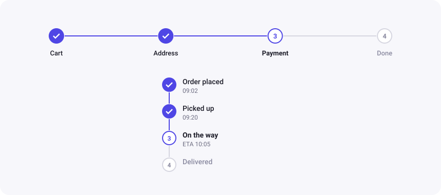

# stepper_progress_lite

[](https://pub.dev/packages/stepper_progress_lite)
[](https://github.com/senkop/stepper_progress_lite/actions/workflows/ci.yml)
[](LICENSE)

A clean step progress indicator for checkouts, onboarding and order tracking. No dependencies.

- Horizontal or vertical
- Check marks on finished steps, numbers on the rest
- Optional subtitles (times, notes)
- Tappable steps
- Theme colors by default



## Install

```bash
flutter pub add stepper_progress_lite
```

## Usage

```dart
import 'package:stepper_progress_lite/stepper_progress_lite.dart';

StepProgress(
  steps: const ['Cart', 'Address', 'Payment', 'Done'],
  current: 2,
)

StepProgress(
  direction: Axis.vertical,
  current: 2,
  steps: const ['Order placed', 'Picked up', 'On the way', 'Delivered'],
  subtitles: const ['09:02', '09:20', 'ETA 10:05', ''],
)
```

## Example

```bash
cd example
flutter create .
flutter run -d chrome
```

## License

MIT
